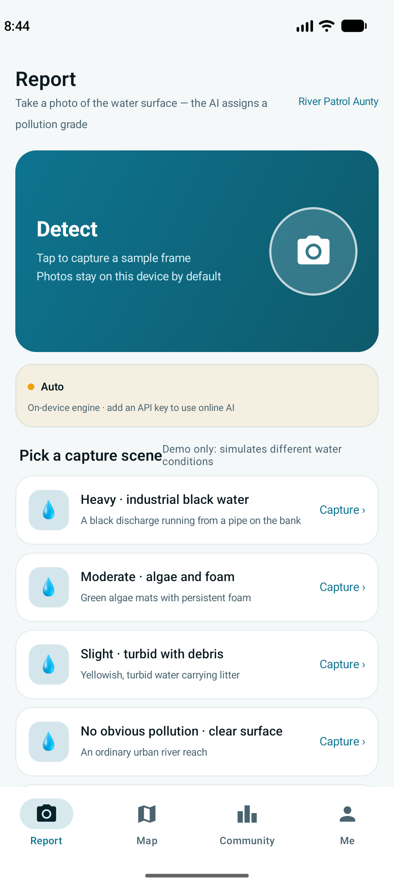
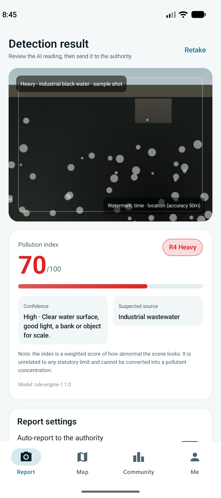
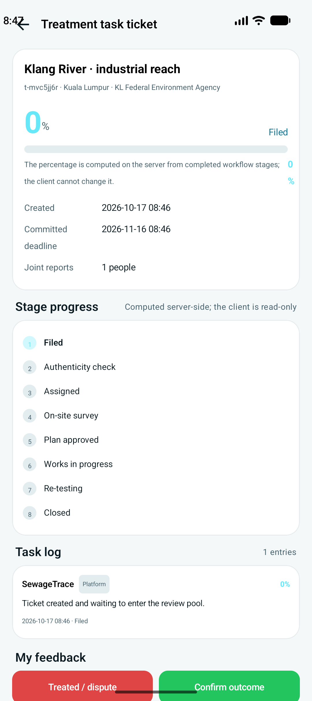

# SewageTrace 污水治理

拍下污水照片 → AI 判定污染等级 → 自动生成工单上报监管部门 → 在地图上找机构、预约线下送检 → 跟踪治理进度。

一个完整的 Android 演示应用，包含客户端、云端识别反代网关和全流程截图。

> **这是演示项目，不是法定检测工具。** 识别结果是「画面视觉异常程度」的视觉线索评分，
> 与任何国家标准限值无关，不得作为执法或维权依据。机构名称与工单数据均为虚构。

---

## 界面预览

| 识别污水 | 识别结果 | 治理进度 |
|---|---|---|
|  |  |  |

| 地图与预约 | 排行榜 | 我的 |
|---|---|---|
|  |  |  |

（截图目录共 34 张，覆盖中英双语、云端识别、离线回退、低置信度拦截等场景）

---

## 快速开始

### 直接安装 APK

到 [Releases](../../releases) 下载最新 `SewageTrace-demo.apk`，直接装到 Android 8.0 以上设备。

装好后在登录页点「Continue with demo account」即可进入，不需要注册。

### 从源码构建

```bash
git clone <本仓库地址>
cd SewageTrace
./gradlew :app:assembleDebug      # macOS / Linux
gradlew.bat :app:assembleDebug    # Windows
```

产物：`app/build/outputs/apk/debug/app-debug.apk`（约 24 MB）

**环境要求**：Android Studio Narwhal+、JDK 17/21、**Android SDK Platform 37**、Build-Tools 36.0.0。

第一次用 Android Studio 打开时会自动生成 `local.properties`（指向你本机 SDK），
所以本仓库**不包含**这个文件 —— 这是正确的，不要手动提交它。

---

## 目录结构

```
.
├─ SewageTrace/              Android 工程（Kotlin + Compose Material 3）
│  ├─ app/src/main/java/com/sewagetrace/app/
│  │  ├─ ai/                 识别引擎：本机规则引擎 / DeepSeek 云端 / 自动回退
│  │  ├─ data/               仓库、上报流程、工单状态机、设置
│  │  ├─ model/              数据类 + 污染等级 R0–R4
│  │  └─ ui/                 4 个 Tab + 详情页
│  ├─ app/src/main/assets/   机构、标准、评分规则、工单流程（JSON 配置）
│  └─ app/src/main/res/      英文（默认）+ 中文，各 553 条字符串
│
├─ gateway/                  DeepSeek 反代网关（Node.js，零依赖）
│  ├─ server.js              转发 + 限流 + 模型白名单 + 令牌管理
│  └─ test/                  12 项自测（含假上游，不消耗真实额度）
│
└─ screenshots/              34 张流程截图
```

**详细开发文档见 [`SewageTrace/README.md`](SewageTrace/README.md)** ——
包含代码结构、识别引擎的四个硬约束、11 条踩坑记录、排错表。

---

## 功能

四个 Tab：

| Tab | 功能 |
|---|---|
| **识别污水** | 拍照 → 污染指数(0–100) + 等级 R0–R4 + 置信度 + 疑似类型 + 证据维度 → 确认上报 |
| **地图** | 机构筛选（政府/送检/污水厂/监测站）、按距离排序、机构详情、**预约线下送检** |
| **社区** | 同城/全国排行榜（7/30/全部）、我的工单进度、全平台工单动态 |
| **我的** | 资料统计、上报记录、我的预约、设置（语言/引擎/密钥/精度/匿名） |

### 污染等级

| 等级 | 指数区间 | 是否自动上报 |
|---|---|---|
| R4 重度 | ≥ 70 | ✅ 附加高危流程 |
| R3 中度 | 50–69 | ✅ |
| R2 轻度 | 30–49 | ✅ |
| R1 轻微 | 15–29 | ❌ 仅存草稿 |
| R0 无明显污染 | < 15 | ❌ 仅存草稿 |

### 关键业务规则

- **置信度为「低」时阻断上报**，只存本地记录并提示补拍（防误报）
- **R0/R1 不自动上报**，只存草稿（防滥用）
- 同一用户 24 小时内、200 米内同一水体重复上报 → 拒绝
- 同一用户每日上限 5 次
- 工单 8 阶段，**进度百分比由服务端按阶段权重计算，客户端只读**
- 72 小时内 1 公里内 ≥3 位不同用户报同一水体 → 自动提级
- 进度 <25% 且闲置 >7 天 → 自动催办

---

## 识别引擎

三档模式，设置里切换：

| 模式 | 行为 |
|---|---|
| **自动**（默认） | 有凭据且联网 → 云端；否则回退本机，**并在结果页显示回退原因** |
| 仅本机 | 只跑规则引擎，抓包零请求 |
| 仅云端 | 只调云端，失败报错不回退 |

### 本机引擎（离线）

`OnDeviceClassifier.kt` 是**规则模型，不是训练模型**：

```
index = 25×颜色与浊度 + 20×漂浮物 + 15×泡沫油膜 + 20×水体与岸边状态 + 10×富营养化 + 10×画质
```

### 云端引擎

调用 DeepSeek `deepseek-flash` 的 OpenAI 兼容视觉接口。四个硬约束写在
[`SewageTrace/README.md`](SewageTrace/README.md) 第四节，改代码前务必读。

---

## 密钥安全：为什么需要网关

**不要把 `sk-` 密钥硬编码进 APK。** 反编译 APK 或 root 手机导出配置都能拿到。

本项目用的是反向代理模式：

```
App ──X-ST-Token: st:xxxx──▶ 你的网关 ──Authorization: Bearer sk-真key──▶ api.deepseek.com
```

APK 只持有网关签发的 `st:` 令牌，真密钥留在服务器。攻击者拿到令牌只能刷这个令牌的配额，
拿不到密钥，也换不了模型。

网关自带：模型白名单、字段白名单、每分钟+每天双限流、令牌吊销、令牌只存哈希。

```bash
cd gateway
cp .env.example .env      # 填 DEEPSEEK_API_KEY 和 ISSUE_SECRET
node server.js            # 零 npm 依赖
node test/forward.test.js # 12 项自测，不消耗真实额度
```

**本仓库不含任何真实密钥**，已做全树扫描确认。

---

## 演示版与正式版的差距

| 项目 | 本仓库 | 正式版需要 |
|---|---|---|
| 地图 | Canvas 手绘示意底图 | 真实 OSM / Google 瓦片 |
| 机构数据 | 虚构名称 | 政府公布的名录 |
| 后端 | 无，全本地 | 真实 API + 鉴权 |
| 上报 | 只写本地工单 | 对接政务系统 / 12345 |
| 政府处理 | 「模拟推进一阶段」按钮 | 真实状态流转 |
| 照片 | Canvas 合成 | CameraX 实拍 + EXIF |
| 识别校准 | 未做 | 用实测报告建校准数据集 |
| 持久化 | SharedPreferences，重装清空 | 数据库 + 云端同步 |

---

## 许可

- 地图图例标注 `© OpenStreetMap contributors, ODbL`，换真实瓦片时**必须保留署名**。
- 机构名称、标准引用均为演示占位，不代表任何真实机构。
- 本项目仅用于学习与技术演示，不对识别结果的准确性作任何担保。
